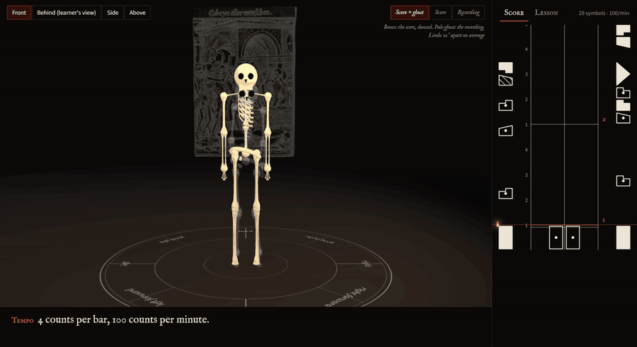
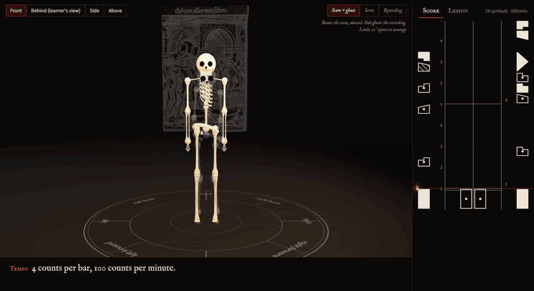
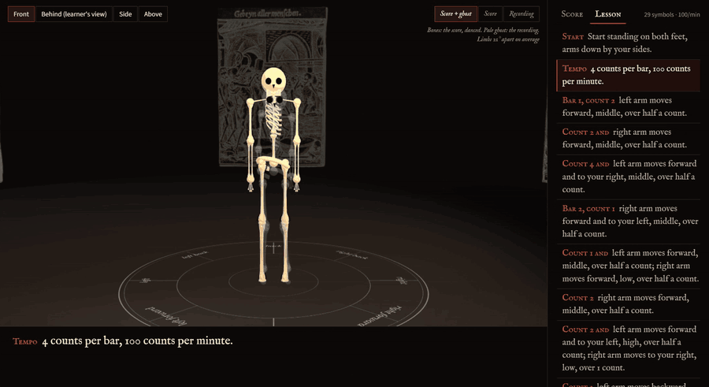
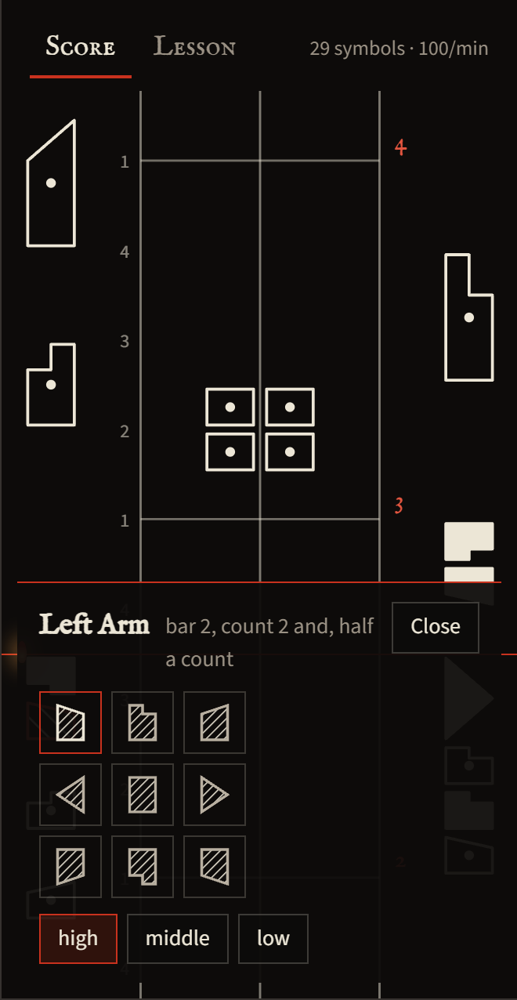
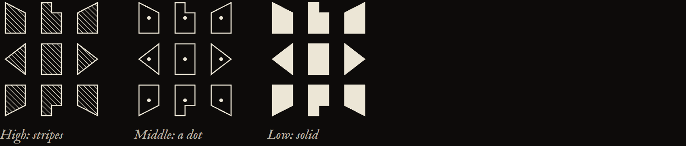
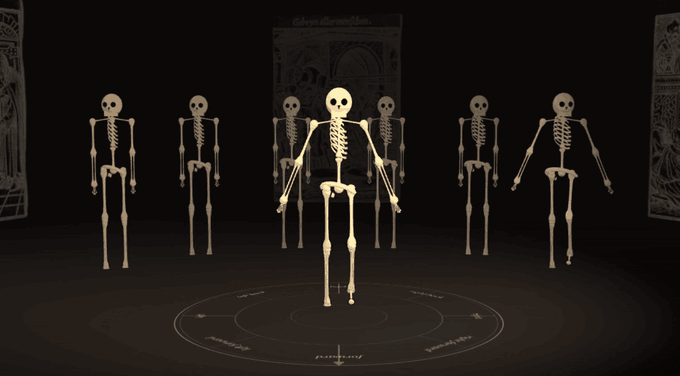

# Danse Macabre

[](https://github.com/Marc-Dvci/danse-macabre/actions/workflows/ci.yml)
[](https://github.com/Marc-Dvci/danse-macabre/actions/workflows/codeql.yml)
[](https://github.com/Marc-Dvci/danse-macabre/actions/workflows/live.yml)
[](LICENSE)


[](https://marc-dvci.github.io/danse-macabre/?dance=macarena#watch)

**Danse Macabre writes dance down. It turns a dance into a Labanotation score, the dance notation Rudolf Laban
published in 1928, plays any score back on a skeleton, and reads it aloud on the count so a blind or low-vision dancer
can learn it.**

A dance teacher, a choreographer or an archive gets a written score that can be edited, searched and replayed; a
blind dancer gets every movement said on its count, in plain words, from the same score.

| | |
|---|---|
| Live app, no login | [marc-dvci.github.io/danse-macabre](https://marc-dvci.github.io/danse-macabre/) · [the Macarena](https://marc-dvci.github.io/danse-macabre/?dance=macarena#watch) · [the finale](https://marc-dvci.github.io/danse-macabre/?dance=finale#watch) · [from video](https://marc-dvci.github.io/danse-macabre/#video) |
| Category | Kiroween 2026, Costume Contest |
| Built with | Kiro CLI (specs, property-based tests, hooks, steering, custom agents, an MCP server and a power), TypeScript, React, Three.js, MediaPipe Pose Landmarker, fast-check, Playwright, axe-core |
| Data | Nine dances from the CMU Graphics Lab Motion Capture Database; two of its reference videos |
| Headline | 307 symbols written from 118.7 s of nine real dances, every one spoken and parsed back; the skeleton follows the recordings within 23.5 degrees on average; read from video, the arms agree with motion capture of the same take in 90% of checks |

> [!TIP]
> Try it in thirty seconds: open [the Macarena](https://marc-dvci.github.io/danse-macabre/?dance=macarena#watch),
> press <kbd>Space</kbd> to play, tick **Read aloud**, then choose **Behind (learner's view)**.

Menu: [For judges](#for-judges) · [See it work](#see-it-work) · [The problem](#the-problem) ·
[How it works](#how-it-works) · [The costume does a job](#the-costume-does-a-job) ·
[How Kiro is used](#how-kiro-is-used) · [Claims](#claims-and-the-tests-that-pin-them) · [Evidence](#evidence) ·
[Run it](#run-it)

## For judges

Code links point at lines in the release tag `v1.0.0`.

| Criterion | Where to look |
|---|---|
| Potential Impact | [The problem](#the-problem). The spoken lesson: [`describe`](https://github.com/Marc-Dvci/danse-macabre/blob/v1.0.0/packages/core/src/lesson.ts#L91-L128), and the law that every word it says comes from a symbol: [`lesson.prop.test.ts`](https://github.com/Marc-Dvci/danse-macabre/blob/v1.0.0/packages/core/test/lesson.prop.test.ts#L111). The learner's view from behind, the bell on the count and "Wait for each line" are on the Watch screen. 0 axe violations on every page ([Evidence](#evidence)) |
| Technological Implementation | [How Kiro is used](#how-kiro-is-used), [`.kiro/`](.kiro) and every run in [`docs/KIRO_BUILD.md`](docs/KIRO_BUILD.md). The engine: [`notate`](https://github.com/Marc-Dvci/danse-macabre/blob/v1.0.0/packages/core/src/notate.ts#L165-L192), [`perform`](https://github.com/Marc-Dvci/danse-macabre/blob/v1.0.0/packages/core/src/perform.ts#L150-L226), and the round trip between them: [`roundtrip.prop.test.ts`](https://github.com/Marc-Dvci/danse-macabre/blob/v1.0.0/packages/core/test/roundtrip.prop.test.ts#L13). The MCP server: [`defineTool`](https://github.com/Marc-Dvci/danse-macabre/blob/v1.0.0/packages/mcp/src/tool.ts#L23-L51), [`resolveInWorkspace`](https://github.com/Marc-Dvci/danse-macabre/blob/v1.0.0/packages/mcp/src/paths.ts#L28-L46) |
| Design | [See it work](#see-it-work) and [The costume does a job](#the-costume-does-a-job). The bones and the ghost, drawn each frame: [`Watch.tsx`](https://github.com/Marc-Dvci/danse-macabre/blob/v1.0.0/web/src/Watch.tsx#L139-L158). The ring of skeletons in canon: [`showEnsemble`](https://github.com/Marc-Dvci/danse-macabre/blob/v1.0.0/web/src/stage/stage.ts#L200-L223) |
| Innovation / Idea | [How it works](#how-it-works). Video to score in the browser: [`readVideo`](https://github.com/Marc-Dvci/danse-macabre/blob/v1.0.0/web/src/capture/poseReader.ts#L126-L153), checked against motion capture of the same take: [`armAgreement`](https://github.com/Marc-Dvci/danse-macabre/blob/v1.0.0/web/src/compare.ts#L98-L116). Phrase search with mirror images: [`findPhrase`](https://github.com/Marc-Dvci/danse-macabre/blob/v1.0.0/packages/core/src/search.ts#L87-L102). Agents read and write dance through nine MCP tools |
| Presentation | The GIFs in [See it work](#see-it-work), the [architecture](#how-it-works), the [claims table](#claims-and-the-tests-that-pin-them) and [`docs/RESULTS.md`](docs/RESULTS.md) |

## See it work

**Watch.** The engine writes the Macarena down from motion capture, symbol by symbol. The skeleton dances only what
the score says, and the recording dances behind it as a pale ghost, so any difference shows. The staff scrolls under
the candle, and the symbol being danced turns red.



**Learn it.** From behind, your left is the dancer's left. Mirror the dance, slow it down, or click a symbol and change
it: the skeleton dances the change at once.



**Hear it.** Every symbol is also a sentence, said on its count. The lesson list follows the dance, and with "Wait for
each line" on, the dance waits until the sentence has been said.



**From video.** The pose model reads a dancer from video in the browser, and the same engine writes the score. On the
CMU reference video of a take, the arms agree with the motion capture of that same take in 90% of checks.


**Search the scores.** Two arm moves cut from the Russian dance are found in three other dances, once as a mirror
image. The search reads symbols, not pixels.


<p>


</p>

**The finale.** Six skeletons dance in canon around a soloist, one bar apart, to Saint-Saëns's *Danse macabre* (1874)
in a 1953 public-domain recording. Kiro choreographed the score through the MCP server.



## The problem

Vaslav Nijinsky made *L'après-midi d'un faune* in 1912 and wrote it down a few years later in a notation of his own.
Nobody could read it for seventy years. In the late 1980s Ann Hutchinson Guest and Claudia Jeschke deciphered it, and
the ballet was danced again from the score. A dance survives when it is written down.

Laban's notation does for movement what sheet music does for sound. The Dance Notation Bureau in New York has kept
more than 800 theatrical scores in it since 1940, and stages 50 to 100 performances a year from them. Few people can
still write it. A dance now lives in a phone video, which a computer cannot read and a blind dancer cannot follow: a
2025 co-design study with 28 participants, blind and low-vision dancers among them, found that tutorial narration
rarely says what the body does in enough detail to learn from, and that hand-written audio description is slow to
make and covers few videos ([Das et al., arXiv 2511.09658](https://arxiv.org/abs/2511.09658)).

Danse Macabre gives the score back to the people who need it: the teacher who wants a dance on paper, the archive that
wants it searchable, and the dancer who learns it by ear.

## How it works

![Architecture: motion capture and video or camera input feed the notation engine in packages/core (body frame, direction and level in one of 26 cells, moves, score); the score drives four outputs, the skeleton, the spoken lesson, the staff and phrase search; the same engine is offered to agents through the MCP server in packages/mcp, which Kiro's choreographer used to compose the finale. The boundary: every symbol, pose and spoken word is computed by the engine, and no language model runs in the app](docs/figures/architecture.png)

One score feeds everything. The engine reads each limb in the dancer's own frame (so "forward" turns with the
dancer), gives it one of 26 direction-and-level cells, and writes a symbol for each move from one rest to the next,
on a half-count grid. Steps and turns go in the support columns, leg gestures beside them, arms outside. The same
score is danced by the skeleton, said as a lesson, drawn as a staff and searched as a phrase.

Deterministic first: every symbol, every replayed pose and every spoken word comes from code in `packages/core`. No
language model decides anything in the app. An agent reaches the notation only through the MCP tools, and every
score it writes is validated before it is saved.

## The costume does a job

Danse Macabre is entered in the Costume Contest. Every spooky element in the interface carries part of the work.

| Element | The job it does |
|---|---|
| The skeleton | Bones show each limb's direction with nothing in the way, so a reader can check a symbol against the body. It dances only what the score says |
| The pale ghost behind it | The recording, centred on the same spot. Where ghost and bones part, the score has left something out |
| The engraved floor ring | Laban's eight directions, turning with the dancer, because in Labanotation "forward" is wherever the dancer faces |
| The candle on the staff | The playhead: the score scrolls under it, and the symbol being danced turns red |
| The bell | Strikes every count, with a deeper tone on the first count of a bar, so the count can be followed without looking |
| The view from behind | Puts the learner's left where the dancer's left is |
| Holbein's woodcuts | The *Dance of Death* (1520s), inverted to bone on ink, line the walls of the stage and open the app |
| The finale | Six skeletons in canon around a soloist, waltzing to Saint-Saëns's *Danse macabre* (1874) from a score Kiro choreographed through the MCP server |

The look holds to one rule: plain words first. Every control says what it does ("Read aloud", "Mirror", "Wait for
each line"), every page passes axe-core with no violations, and the layout holds on a 390-pixel phone screen.

## How Kiro is used

Kiro built the notation engine (`packages/core`), its tests, the MCP server (`packages/mcp`) and the Kiro power from
specs, through the Kiro CLI driven headless. I wrote each spec's requirements in EARS form and the steering; Kiro
wrote each `design.md` and `tasks.md`, then the code and the tests, task by task. The web app is built around the
engine's public API.

| Kiro feature | What it does here |
|---|---|
| Specs | Five specs in [`.kiro/specs/`](.kiro/specs): `laban-core` (score model, quantisation, notation, playback, mirror, tempo), `supports-and-turns`, `lesson-search-layout` (spoken lesson, phrase search, staff layout and SVG), `fidelity` (the replay measure) and `dance-mcp`. The 1928 rules are the requirements |
| Property-based testing | The laws of the notation as 33 fast-check properties, 100 to 500 generated cases each (200 for most): every limb direction falls in exactly one of the 26 cells; mirroring twice gives the dance back; mirroring commutes with notation; dancing a score and writing it down again gives the same score; the spoken lesson parses back into the same symbols, and every word it says comes from a symbol |
| Hooks | [`guard.json`](.kiro/hooks/guard.json) refuses deletes, pushes and credential reads before any tool runs; [`properties-on-save.json`](.kiro/hooks/properties-on-save.json) runs the property tests whenever Kiro saves engine code; [`verify-on-stop.json`](.kiro/hooks/verify-on-stop.json) typechecks and tests everything when a session ends; [`notate-new-clip.json`](.kiro/hooks/notate-new-clip.json) writes a newly saved dance clip down as a score, a staff and a lesson; [`render-saved-score.json`](.kiro/hooks/render-saved-score.json) draws every score an agent saves and writes its lesson |
| Steering | [`product.md`](.kiro/steering/product.md), [`tech.md`](.kiro/steering/tech.md), [`rules.md`](.kiro/steering/rules.md), and [`notation.md`](.kiro/steering/notation.md), loaded only for engine and spec files, which carries the Labanotation subset |
| Custom agents | [`notator`](.kiro/agents/notator.json) builds from the specs and cannot edit its own rules; [`repetiteur`](.kiro/agents/repetiteur.json) reviews and can write nothing; [`choreographer`](.kiro/agents/choreographer.json) composes through the dance tools and writes only to `examples/` |
| MCP | [`packages/mcp`](packages/mcp): nine tools (`notate_clip`, `compose_score`, `validate_score`, `describe_score`, `mirror_score`, `retime_score`, `find_phrase`, `perform_score`, `render_score_svg`) and every clip as a `clip://` resource, registered for Kiro in [`.kiro/settings/mcp.json`](.kiro/settings/mcp.json) |
| Power | [`power/labanotation`](power/labanotation): the MCP server and a skill, [`read-and-write-dance`](power/labanotation/skills/read-and-write-dance/SKILL.md), so any Kiro user can give an agent the ability to read and write dance |

Every run is in [`docs/KIRO_BUILD.md`](docs/KIRO_BUILD.md): 15 sessions, 56.95 credits, 105 files in this repository
written or edited by Kiro, each counted from Kiro's own records.

Kiro asked before it bent a rule. When the first round-trip property failed, it traced the failure to two
requirements that contradicted each other and asked which one to change, instead of weakening the test. When real
motion capture of the Macarena produced only four arm symbols, it measured why (dancers sway while they hold a
position, so their speed never reaches a true rest) and the spec gained a rule for holds.

## What it guarantees

- **Video stays on the device.** The pose model runs in the browser; frames from a video file or the camera are read
  there and never uploaded.
- **Every spoken word comes from a symbol.** A property test parses each lesson back into its symbols, and a wording
  check ([`check-words.mjs`](scripts/check-words.mjs)) runs in CI on every push.
- **Agents stay in their workspace.** The MCP server refuses a path that climbs out of its workspace or a link that
  leads out, and refuses an invalid score with every problem listed.
- **The builder cannot do harm.** Kiro's `PreToolUse` guard hook refuses deletes, pushes and credential reads before
  any tool runs.

## Claims and the tests that pin them

| Claim | Code | Test |
|---|---|---|
| Every limb direction falls in exactly one of 26 cells | [`quantize.ts`](packages/core/src/quantize.ts) | [`quantize.prop.test.ts`](packages/core/test/quantize.prop.test.ts) |
| Dancing a score and writing it down again gives the same score, for gestures, steps and turns | [`perform.ts`](packages/core/src/perform.ts), [`notate.ts`](packages/core/src/notate.ts) | [`roundtrip.prop.test.ts`](packages/core/test/roundtrip.prop.test.ts), [`supports-roundtrip.prop.test.ts`](packages/core/test/supports-roundtrip.prop.test.ts) |
| Mirroring twice gives the dance back, and mirroring commutes with notation | [`mirror.ts`](packages/core/src/mirror.ts) | [`mirror.prop.test.ts`](packages/core/test/mirror.prop.test.ts), [`supports-mirror.prop.test.ts`](packages/core/test/supports-mirror.prop.test.ts) |
| The spoken lesson parses back into the same symbols, and each word comes from one | [`lesson.ts`](packages/core/src/lesson.ts), [`lesson-parse.ts`](packages/core/src/lesson-parse.ts) | [`lesson.prop.test.ts`](packages/core/test/lesson.prop.test.ts) |
| Doubling the tempo halves the time and changes nothing else | [`mirror.ts`](packages/core/src/mirror.ts) (`retime`) | [`tempo.prop.test.ts`](packages/core/test/tempo.prop.test.ts) |
| Real motion capture is written down: the Macarena's arms start forward, middle | [`notate.ts`](packages/core/src/notate.ts) | [`macarena.test.ts`](packages/core/test/macarena.test.ts), [`clips-supports.test.ts`](packages/core/test/clips-supports.test.ts) |
| A skeleton dancing its own score reads below 1 degree on the replay measure, whatever its facing | [`fidelity.ts`](packages/core/src/fidelity.ts) | [`fidelity.prop.test.ts`](packages/core/test/fidelity.prop.test.ts) |
| Phrase search finds a phrase and its mirror image | [`search.ts`](packages/core/src/search.ts) | [`search.prop.test.ts`](packages/core/test/search.prop.test.ts), [`app.spec.ts`](web/e2e/app.spec.ts) |
| The MCP tools refuse bad input and paths outside the workspace, and never throw | [`tool.ts`](packages/mcp/src/tool.ts), [`paths.ts`](packages/mcp/src/paths.ts) | [`tools.test.ts`](packages/mcp/test/tools.test.ts), [`paths.test.ts`](packages/mcp/test/paths.test.ts) |
| Every page has no axe violations; the lesson follows the dance; the layout holds at 390 pixels | [`web/src`](web/src) | [`app.spec.ts`](web/e2e/app.spec.ts) |

## Evidence

Every figure comes from [`docs/RESULTS.md`](docs/RESULTS.md), written by `node scripts/count-tests.mjs` and
`pnpm exec tsx scripts/results.ts`.

| Claim | Measure |
|---|---|
| It writes real dances down | 307 symbols from 118.7 seconds of nine CMU dances: arm and leg gestures, steps (65 in the salsa), all valid scores |
| Every spoken word comes from a symbol | For all nine dances, the spoken lesson parses back into the same symbols; property-tested on generated scores, with turns |
| The skeleton dances what was danced | Replay fidelity, the angle between each limb in the recording and in the skeleton dancing the score: 17.0 to 37.4 degrees per dance, 23.5 on average. Directions are 45 degrees apart, so 22.5 is half a direction |
| It reads video | On the CMU reference video of a take, the arms hold the same direction and level as in the motion capture of that take in 90% of 70 checks (93% the same or a neighbouring cell); 52% (66%) on a turning take filmed from behind |
| The notation keeps its laws | 33 fast-check properties, 100 to 500 generated cases each, at the fixed seed 1928 in CI, and at further seeds in [`docs/measure/fidelity.md`](docs/measure/fidelity.md) |
| Phrase search finds mirror images | In all nine dances, the first two bars are found, mirrored, at their own beat in the mirrored dance |
| Tests | 154 engine tests, 52 MCP server tests and 13 browser tests with axe-core (0 violations on every page): 219 in all, in random order, in CI on every push |
| Coverage | Engine: 99.44% of lines, 92.82% of branches. MCP server: 97.26% of lines, 76.85% of branches. CI fails below the floors |

The notation rules were tuned by one number, replay fidelity on the nine dances, and checked against the properties
at every step: the average went from 40.1 degrees with the first rules to 23.5 with the current ones
([`docs/measure/fidelity.md`](docs/measure/fidelity.md)).

> [!IMPORTANT]
> The nine dances are real motion-capture takes from the CMU Graphics Lab database, and the two videos are CMU's own
> reference videos of two of those takes.

## Run it

Node 22 or later and pnpm 9 (`corepack enable` provides it). No keys and no accounts.

```bash
pnpm install
pnpm --filter @danse/web dev        # the app on http://localhost:5173
pnpm -r test                        # engine and MCP server tests
pnpm --filter @danse/web exec playwright install chromium
pnpm --filter @danse/web e2e        # the app in a real browser, with axe
```

[](https://codespaces.new/Marc-Dvci/danse-macabre?quickstart=1)
opens the app in a browser editor with nothing installed.

With Docker:

```bash
docker compose up demo                         # the app on http://127.0.0.1:8080
docker compose --profile mcp run --rm -T mcp   # the MCP server on stdio, for an agent
```

The MCP server for Kiro or any agent: `pnpm exec tsx packages/mcp/src/bin.ts` from the repository root. Its workspace
is `DANSE_WORKSPACE` or the current folder: it reads the clips in `data/clips` there and writes only inside it. In Kiro
it is already registered in `.kiro/settings/mcp.json`, and `power/labanotation` installs it as a power. Every dance
written down, as a score, a staff and a lesson, is in [`examples/`](examples).

| Folder | What is in it |
|---|---|
| `packages/core` | The notation engine and its tests |
| `packages/mcp` | The MCP server and its tests |
| `web` | The app (React, Three.js, MediaPipe) and its browser tests |
| `data/clips` | The nine CMU dances, converted by `tools/cmu_import.py` |
| `examples` | Every dance as a score, a staff (SVG) and a lesson; the finale and the curtain call composed by Kiro |
| `.kiro` | Specs, steering, hooks, agents and the MCP registration |
| `docs` | Results, the Kiro build ledger, the measures and the figures |

## Credits

- Dances: CMU Graphics Lab Motion Capture Database, mocap.cs.cmu.edu (free for all uses, no resale; created with
  funding from NSF EIA-0196217). Subjects and trials are listed in `data/clips/index.json`.
- Woodcuts: Hans Holbein the Younger, *Dance of Death* (1520s), scans by the Cleveland Museum of Art, CC0.
- Music: Camille Saint-Saëns, *Danse macabre* (1874), Orchestre des Concerts Colonne, Louis Fourestier (1953), public
  domain, from the Bibliothèque nationale de France via Wikimedia Commons.
- Pose reading: MediaPipe Pose Landmarker (Apache 2.0).

## Licence

Apache 2.0, see [LICENSE](LICENSE).
