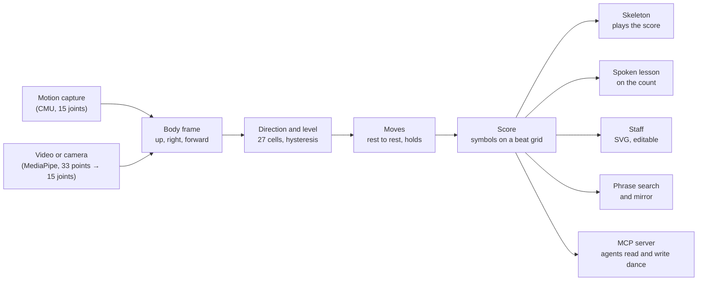

# Danse Macabre

**Danse Macabre writes dance down. It turns a dance into a Labanotation score, the dance notation Rudolf Laban
published in 1928, plays any score back on a skeleton, and reads it aloud on the count so a blind or low-vision dancer
can learn it.**

A dance teacher, a choreographer or an archive gets a written score that can be edited, searched and replayed; a
blind dancer gets every movement said on its count, in plain words, from the same score.

| | |
|---|---|
| Live app, no login | _deploy link_ |
| Category | Kiroween 2026, Costume Contest |
| Built with | Kiro CLI (specs, property-based tests, hooks, steering, custom agents, an MCP server and a power), TypeScript, React, Three.js, MediaPipe Pose Landmarker, fast-check, Playwright, axe-core |
| Data | Nine dances from the CMU Graphics Lab Motion Capture Database; two of its reference videos |

Menu: [See it work](#see-it-work) · [The problem](#the-problem) · [How it works](#how-it-works) ·
[The costume does a job](#the-costume-does-a-job) · [How Kiro is used](#how-kiro-is-used) · [Evidence](#evidence) ·
[Quickstart](#quickstart) · [Credits](#credits)

## See it work

_figures and GIFs_

## The problem

Vaslav Nijinsky made *L'après-midi d'un faune* in 1912 and wrote it down a few years later in a notation of his own.
Nobody could read it for seventy years. In the late 1980s Ann Hutchinson Guest and Claudia Jeschke deciphered it, and
the ballet was danced again from the score. A dance survives when it is written down.

Laban's notation does for movement what sheet music does for sound. The Dance Notation Bureau in New York has kept
more than 800 theatrical scores in it since 1940, and stages 50 to 100 performances a year from them. Few people can
still write it. A dance now lives in a phone video, which a computer cannot read and a blind dancer cannot follow: a
2025 co-design study with 28 participants, blind and low-vision dancers among them, found that tutorial narration
rarely says what the body does in enough detail to learn from, and that hand-written audio description is slow to
make and covers few videos ([Das et al., arXiv 2511.09658](https://arxiv.org/abs/2511.09658)).

## How it works



Deterministic first: every symbol, every replayed pose and every spoken word comes from code in `packages/core`. No
language model decides anything in the app.

## The costume does a job

## How Kiro is used

Kiro built the notation engine (`packages/core`) and its tests from specs, through the Kiro CLI driven headless. I
wrote each spec's requirements in EARS form and the steering; Kiro wrote each `design.md` and `tasks.md`, then the
code and the tests, task by task. The web app is built around the engine's public API.

| Kiro feature | What it does here |
|---|---|
| Specs | Four specs in [`.kiro/specs/`](.kiro/specs): `laban-core` (score model, quantisation, notation, playback, mirror, tempo), `supports-and-turns`, `lesson-search-layout` (spoken lesson, phrase search, staff layout and SVG) and `dance-mcp`. The 1928 rules are the requirements |
| Property-based testing | The laws of the notation as fast-check properties, 200 runs each: every limb direction falls in exactly one of the 26 cells; mirroring twice gives the dance back; mirroring commutes with notation; dancing a score and writing it down again gives the same score; the spoken lesson parses back into the same symbols, and every word it says comes from a symbol |
| Hooks | [`guard.json`](.kiro/hooks/guard.json) refuses deletes, pushes and credential reads before any tool runs; [`properties-on-save.json`](.kiro/hooks/properties-on-save.json) runs the property tests whenever Kiro saves engine code; [`verify-on-stop.json`](.kiro/hooks/verify-on-stop.json) typechecks and tests everything when a session ends; [`notate-new-clip.json`](.kiro/hooks/notate-new-clip.json) writes a newly saved dance clip down as a score, a staff and a lesson |
| Steering | [`product.md`](.kiro/steering/product.md), [`tech.md`](.kiro/steering/tech.md), [`rules.md`](.kiro/steering/rules.md), and [`notation.md`](.kiro/steering/notation.md), loaded only for engine and spec files, which carries the Labanotation subset |
| Custom agents | [`notator`](.kiro/agents/notator.json) builds from the specs and cannot edit its own rules; [`repetiteur`](.kiro/agents/repetiteur.json) reviews and can write nothing |

Kiro asked before it bent a rule. When the first round-trip property failed, it traced the failure to two
requirements that contradicted each other and asked which one to change, instead of weakening the test. When real
motion capture of the Macarena produced only four arm symbols, it measured why (dancers sway while they hold a
position, so their speed never reaches a true rest) and the spec gained a rule for holds.

## Evidence

## Quickstart

```bash
pnpm install
pnpm --filter @danse/web dev        # the app on http://localhost:5173
pnpm -r test                        # unit and property tests
pnpm --filter @danse/web e2e        # the app in a real browser, with axe
```

## Credits

- Dances: CMU Graphics Lab Motion Capture Database, mocap.cs.cmu.edu (free for all uses, no resale; created with
  funding from NSF EIA-0196217). Subjects and trials are listed in `data/clips/index.json`.
- Woodcuts: Hans Holbein the Younger, *Dance of Death* (1520s), scans by the Cleveland Museum of Art, CC0.
- Music: Camille Saint-Saëns, *Danse macabre* (1874), Orchestre des Concerts Colonne, Louis Fourestier (1953), public
  domain, from the Bibliothèque nationale de France via Wikimedia Commons.
- Pose reading: MediaPipe Pose Landmarker (Apache 2.0).

## Licence

Apache 2.0, see [LICENSE](LICENSE).
